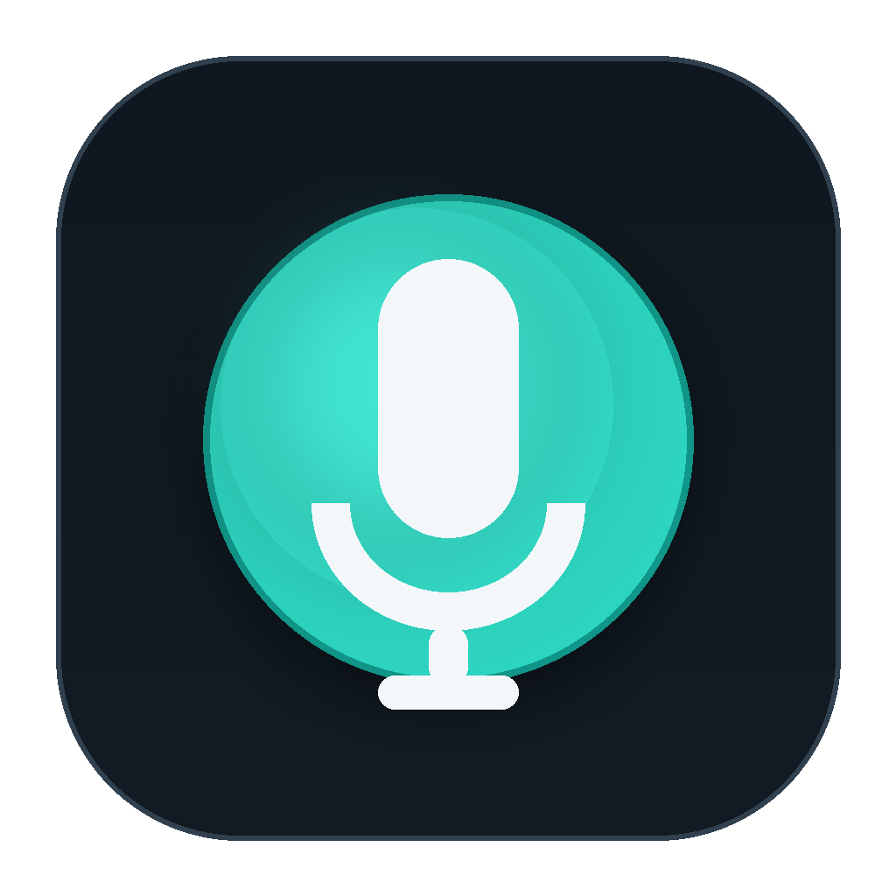

# JT Copilot

<p align="center">
  
</p>

<p align="center">
  跨应用桌面语音写作助手，让口述直接进入当前编辑器，并在写作过程中持续给出下一步提示。
</p>

JT Copilot 是一个本地优先的桌面写作工具。它会捕捉当前编辑器的焦点，将实时语音识别结果写入光标位置，并在独立面板中展示下一句、写作方向和可能遗漏的信息。会话结束后，应用会合并重复片段、纠正术语与标点，并尝试原位替换本次写入的内容。

> 项目仍在快速迭代。核心链路已经可运行，但不同编辑器和操作系统版本的支持程度并不完全一致。

## 核心能力

- 通过全局快捷键开始和结束一次语音写作会话。
- 实时识别并逐字写入飞书、Word、备忘录、VS Code 等当前编辑器。
- 在独立引导面板中展示文档模板、当前框架、下一句、写作方向和遗漏点。
- 使用本地模板引擎即时推进内容结构，模型建议不会阻塞文字写入。
- 自动修正业务术语、英文缩写和用户自定义别名。
- 会话结束后调用智谱模型去重、纠正并润色全文。
- 仅对显式会话录音，不上传整个屏幕，不扫描无关文档。
- API Key 使用系统安全存储，不进入源码、设置文件或日志。

## 平台支持

| 平台 | 技术栈 | 实时识别 | 跨应用写入 | 密钥存储 |
| --- | --- | --- | --- | --- |
| macOS 14+ | Swift、SwiftUI、AppKit | Apple Speech | Accessibility + CGEvent | macOS Keychain |
| Windows 11 | .NET 10、WPF、MVVM | 本地 Vosk | UI Automation + 键盘输入降级 | DPAPI / 环境变量 |

macOS 版本位于 [`macos/`](macos/README.md)，包含独立的构建、权限和兼容性说明。

## 快速开始

### macOS

环境要求：

- macOS 14 Sonoma 或更高版本
- Xcode 15+ 或 Command Line Tools
- 可用的麦克风
- 智谱 API Key

```bash
git clone https://github.com/kahing7/JT-Copilot-mac.git
cd JT-Copilot-mac

bash "配置智谱Key.command"
bash macos/scripts/install_to_launchpad.sh
```

也可以直接双击项目根目录的 `安装到启动台.command`。构建完成后，应用会安装到 `~/Applications` 并自动打开。

首次启动需要授予以下权限：

1. 麦克风：采集语音。
2. 语音识别：生成实时转录。
3. 辅助功能：监听全局快捷键并向其他应用写入文字。

如果重新构建后快捷键或写入失效，请退出应用并在“系统设置 > 隐私与安全性 > 辅助功能”中重新授权。

详细说明见 [`macos/README.md`](macos/README.md)。

### Windows

环境要求：

- Windows 11 x64
- .NET SDK `10.0.402` 或兼容的 .NET 10 SDK
- 可用的麦克风
- 智谱 API Key

```powershell
dotnet restore JT.Copilot.slnx
dotnet build JT.Copilot.slnx
dotnet test JT.Copilot.slnx
dotnet run --project src/JT.Copilot.Desktop/JT.Copilot.Desktop.csproj
```

设置窗口不保存智谱 API Key。启动前可在当前 PowerShell 会话中安全输入：

```powershell
$env:ZHIPU_API_KEY = Read-Host "Zhipu API Key"
dotnet run --project src/JT.Copilot.Desktop/JT.Copilot.Desktop.csproj
```

Windows 也支持读取当前用户 DPAPI 保护的密钥文件，但不要把该文件复制到仓库或提交到版本控制。

## 使用方式

1. 把光标放到目标编辑器中的可编辑位置。
2. 按下 `Ctrl + Shift + J + T` 开始会话；macOS 对应 `⌃⇧J T`。
3. 正常说话，识别文字会实时写入，并在会话结束时统一优化。
4. 按 `Esc` 结束并触发全文校正。
5. 右键悬浮球可打开设置、控制引导面板、切换置顶或退出应用。

默认快捷键可以在设置中重新录制。macOS 额外提供菜单栏入口。

## 隐私与安全

- 录音只在用户显式开始会话后发生，会话结束或取消后停止。
- 当前代码未集成第三方遥测或分析 SDK。
- 实时识别、分片校正和全文优化会按功能需要调用 Apple Speech 或智谱 API。
- macOS API Key 保存在 Keychain；Windows 支持环境变量和当前用户 DPAPI 文件。
- 密钥、录音、转录和本机配置不得提交到 Git 仓库。
- 如果密钥曾出现在截图、日志、聊天记录或提交历史中，请立即在服务商控制台轮换。

本地数据默认位置：

```text
# macOS
~/Library/Application Support/JT Copilot/
├── settings.json
└── recordings/

# Windows
%LOCALAPPDATA%\JT Copilot\
├── settings.json
├── recordings\
├── secrets\
└── models\
```

发现安全问题时，请不要公开提交包含敏感数据的 Issue。处理方式见 [`SECURITY.md`](SECURITY.md)。

## 工程结构

```text
.
├── src/
│   ├── JT.Copilot.Domain/          # 领域模型与状态
│   ├── JT.Copilot.Application/     # 会话编排与抽象接口
│   ├── JT.Copilot.Infrastructure/  # 音频、系统集成、模型客户端和存储
│   ├── JT.Copilot.Desktop/         # Windows WPF 应用
│   └── JT.Copilot.Contracts/       # 跨模块 DTO
├── tests/                          # Windows 单元与集成测试
├── macos/
│   ├── Sources/JTCopilot/          # macOS AppKit / SwiftUI 应用
│   ├── Sources/JTCopilotCore/      # 跨平台核心逻辑
│   ├── Tests/JTCopilotCoreTests/   # Swift 单元测试
│   └── scripts/                    # 构建与安装脚本
├── docs/                           # 架构、决策和验证记录
└── PROJECT_SPEC.md                 # 产品与技术规格
```

更完整的设计说明：

- [架构设计](docs/architecture.md)
- [技术决策](docs/decisions.md)
- [兼容性矩阵](docs/compatibility-matrix.md)
- [产品与技术规格](PROJECT_SPEC.md)

## 开发与测试

macOS 核心逻辑测试：

```bash
cd macos
swift test
```

构建完整 macOS 应用：

```bash
cd macos
bash scripts/build_app.sh
```

需要 Intel 与 Apple Silicon 通用包时：

```bash
cd macos
UNIVERSAL=1 bash scripts/build_app.sh
```

Windows 构建与测试：

```powershell
dotnet build JT.Copilot.slnx
dotnet test JT.Copilot.slnx
```

提交前请至少运行与改动平台对应的测试，并确认 `git diff --cached` 中没有密钥、录音、日志、签名证书或本机配置。

## 已知限制

- 不同编辑器对 Accessibility 或 UI Automation 的支持存在差异，最终原位替换可能失败。
- 若目标应用焦点发生变化，实时写入会暂停，避免文字进入错误窗口。
- 密码输入框不会接收自动写入。
- 实时识别结果可能在后续片段到达时回改前文。
- 智谱识别仍可能误判专有名词，可将高频术语加入业务词表。
- Apple Speech 的本地或在线行为取决于系统语言包、网络和用户设置。
- 当前没有自动更新、安装包签名或公证流程。

## 参与贡献

欢迎提交 Issue 和 Pull Request。请尽量做到：

- 一个提交只解决一个明确问题。
- 保持 Windows 与 macOS 两端共享行为的语义一致。
- 为可复用的核心逻辑补充测试。
- 不提交 API Key、录音、转录、日志、证书或本机绝对路径。
- 描述实际验证过的平台、编辑器和测试结果。

提交信息建议使用 Conventional Commits，例如：

```text
feat(macos): add docked guidance panel
fix(windows): restore focus before text insertion
docs: clarify privacy and key storage
```

## License

本项目采用 [MIT License](LICENSE)。
